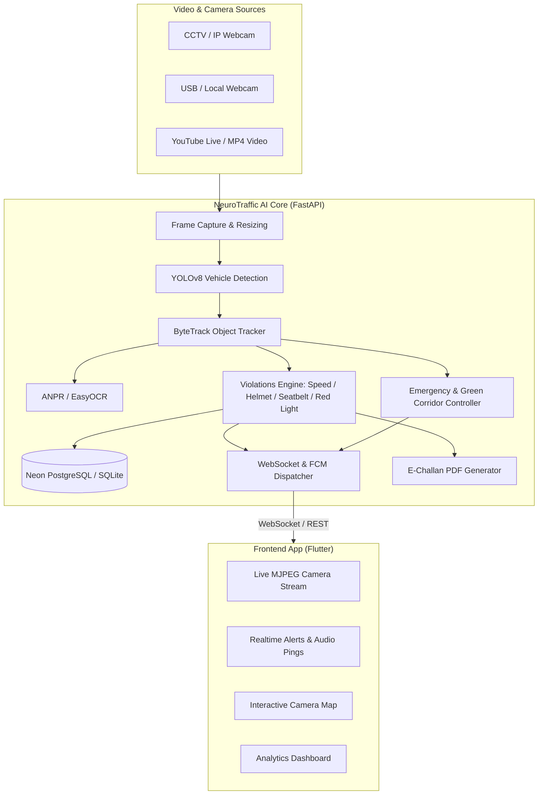

# 🚦 NeuroTraffic: Next-Gen Autonomous Traffic Intelligence & Road Safety Platform

<p align="center">
  
  
  
  
  
  
  
</p>

---

## 📌 Overview

**NeuroTraffic** is an end-to-end, AI-powered Smart City surveillance and traffic governance ecosystem. By combining state-of-the-art computer vision models (**YOLOv8**, **ByteTrack**, and **EasyOCR**) with a high-throughput **FastAPI** backend and a reactive **Flutter** mobile client, NeuroTraffic autonomously audits urban roadways in real-time.

From detecting moving violations and identifying potholes to automating **Green Corridors** for life-saving emergency vehicles and generating evidence-backed **E-Challan PDFs**, NeuroTraffic turns ordinary CCTV and IP cameras into intelligent municipal assets.

---

## ⚡ Key Features

### 🎯 1. Multi-Class Vehicle Detection & Tracking
- Detects and categorizes vehicles into **Cars, Motorcycles, Buses, and Trucks** using **YOLOv8**.
- Continuous multi-object tracking powered by **ByteTrack**, preserving vehicle identity across occlusions.
- Bidirectional line crossing counters with dynamic density computation.

### 🚨 2. Automated Violation Detection Suite
- **⚡ Overspeeding Detection**: Real-time velocity computation calibrated using metric pixel-to-meter matrices.
- **⛔ Wrong-Way Driving**: Vector displacement validation against allowable street trajectory profiles.
- **🛑 Red-Light Infringements**: Virtual tripwires and stop-line cross-referencing during signal phases.
- **🪖 No-Helmet Detection**: Spatial correlation of riders and two-wheelers without protective gear.
- **💺 Seatbelt Compliance**: Driver-cockpit area cropping and visual compliance validation.
- **↔️ Lane Departure / Straddling**: Monitors vehicle positions relative to lane markings.

### 💥 3. Incident Management & Hazard Detection
- **💥 Collision & Accident Detection**: Detects abrupt deceleration spikes coupled with bounding-box intersections.
- **🕳️ Pothole & Road Hazard Mapping**: Detects road surface defects, geolocating and deduplicating by coordinates.

### 🚑 4. Smart Signal Preemption & "Green Corridor"
- Identifies **Ambulances, Fire Engines, and Police units** through vision cues and ANPR keyword matching (`108`, `AMBULANCE`, `POLICE`, `FIRE`).
- Automatically triggers **Green Corridor preemption**, holding green lights along the emergency path.

### 🔍 5. ANPR & Automatic E-Challan Generation
- High-accuracy license plate localization and text extraction using **EasyOCR**.
- Generates official, tamper-evident **E-Challan PDFs** (via ReportLab) complete with fine amounts, violator snapshot, license plate, and violation details.

### 📱 6. Multi-Platform Flutter Client
- **Live Stream Viewer**: Zero-latency MJPEG streaming with real-time detection bounding boxes.
- **Interactive Camera Map**: Geographic distribution of deployed camera nodes and their live status.
- **Real-Time Alert Feed**: Push notifications via **Firebase Cloud Messaging (FCM)** and instant **WebSocket** alerts.
- **Traffic Analytics**: Visual dashboards showing density graphs, violation distributions, and speed metrics.

---

## 🏗️ Architecture



---

## 📂 Repository Structure

```plaintext
NeuroTraffic/
├── .gitignore                     # Production Git ignore (Secrets, Models, Builds)
├── README.md                      # Documentation & Project Guide
│
├── backend/                       # Python & AI Engine (FastAPI)
│   ├── detection/                 # Detection sub-modules
│   │   ├── accident.py            # Collision & crash detection logic
│   │   ├── density.py             # Road congestion & vehicle count
│   │   ├── emergency.py           # Emergency vehicle & Green Corridor logic
│   │   ├── face.py                # Driver face detection & cropping
│   │   ├── helmet.py              # Motorcycle helmet compliance
│   │   ├── lane.py                # Lane discipline & departures
│   │   ├── pipeline.py            # Main multi-camera inference loop
│   │   ├── plate.py               # ANPR & OCR plate extractor
│   │   ├── pothole.py             # Road pothole & hazard detector
│   │   ├── redlight.py            # Stop-line red-light infringements
│   │   ├── seatbelt.py            # Driver seatbelt compliance
│   │   ├── speed.py               # Pixel-calibrated velocity estimator
│   │   └── wrong_way.py           # Traffic flow vector validation
│   ├── alerts.py                  # Alert deduplication & DB logging
│   ├── auth.py                    # JWT authentication & bcrypt security
│   ├── challan_generator.py       # Automated PDF E-Challan generator
│   ├── config.py                  # Central configuration & tuning parameters
│   ├── database.py                # SQLAlchemy models & DB connection
│   ├── main.py                    # FastAPI server entrypoint & REST routes
│   ├── push_notifications.py      # Firebase Admin FCM dispatcher
│   ├── requirements.txt           # Python backend dependencies
│   ├── signal_state.py            # Traffic light state machine
│   └── websocket_manager.py       # Live client connection manager
│
└── traffic_ai_app/                # Mobile & Web Frontend (Flutter)
    ├── lib/
    │   ├── screens/               # Dashboard, Live View, Map, Alerts, Analytics
    │   ├── services/              # API Client, WebSocket & FCM services
    │   ├── widgets/               # Reusable UI components & stat cards
    │   └── main.dart              # Flutter application entrypoint
    └── pubspec.yaml               # Flutter package configuration
```

---

## 🛠️ Tech Stack

| Domain | Technologies & Libraries |
| :--- | :--- |
| **Backend Framework** | [FastAPI](https://fastapi.tiangolo.com/), [Uvicorn](https://www.uvicorn.org/), Pydantic v2 |
| **Computer Vision** | [OpenCV](https://opencv.org/), [Ultralytics YOLOv8](https://github.com/ultralytics/ultralytics), [Supervision](https://supervision.roboflow.com/) |
| **Tracking & OCR** | ByteTrack, [EasyOCR](https://github.com/JaidedAI/EasyOCR), Pillow, NumPy, SciPy |
| **Database & ORM** | [Neon PostgreSQL](https://neon.tech/) (or SQLite), [SQLAlchemy 2.0](https://www.sqlalchemy.org/) |
| **Authentication** | OAuth2 with Password Flow, JWT (`python-jose`), `bcrypt` |
| **Mobile & Frontend** | [Flutter 3.x](https://flutter.dev/), Dart, Provider |
| **Realtime & Cloud** | WebSockets, Firebase Cloud Messaging (FCM), [ReportLab](https://www.reportlab.com/) |

---

## 🚀 Getting Started

### 1. Prerequisites
- **Python 3.10 to 3.12**
- **Flutter SDK** (3.19+ recommended)
- **Git**

---

### 2. Backend Installation

1. **Clone the repository:**
   ```bash
   git clone https://github.com/mittal987-alt/NeuroTraffic.git
   cd NeuroTraffic/backend
   ```

2. **Create and activate a virtual environment:**
   ```powershell
   # Windows PowerShell
   python -m venv venv
   .\venv\Scripts\Activate.ps1

   # Linux / macOS
   python3 -m venv venv
   source venv/bin/activate
   ```

3. **Install dependencies:**
   ```bash
   pip install -r requirements.txt
   ```

4. **Configure Environment Variables:**
   Create a `.env` file in the `backend/` folder (or copy `.env.example`):
   ```env
   # Database (Defaults to SQLite if omitted)
   DATABASE_URL=sqlite:///./traffic.db

   # Security & Roles
   JWT_SECRET_KEY=your-super-secret-jwt-key-here
   ADMIN_EMAILS=admin@trafficvision.ai

   # Signal Mode: "simulated" | "manual" | "api"
   SIGNAL_MODE=simulated
   SIGNAL_API_URL=

   # Privacy & Retention
   ENABLE_FACE_CAPTURE=false
   FACE_RETENTION_DAYS=7

   # False-Positive Reduction
   CONSECUTIVE_VIOLATION_CHECKS=3

   # Camera Input
   CAMERA_1_VIDEO_PATH=traffic.mp4

   # Detection Calibration
   CONF_THRESHOLD=0.4
   SPEED_LIMIT_KMH=80.0
   PIXELS_PER_METER=8.0
   DETECTION_FRAME_SKIP=4
   WHOLE_FRAME_CHECK_INTERVAL=30
   JPEG_QUALITY=60
   DETECTION_RESIZE_WIDTH=640

   # External Cloud & Notification Services
   FIREBASE_SERVICE_ACCOUNT_PATH=firebase-service-account.json
   FCM_DEVICE_TOKEN=PASTE_YOUR_FCM_TOKEN_HERE
   ROBOFLOW_API_KEY=your-roboflow-api-key
   ```

5. **Run the Backend Server:**
   ```bash
   uvicorn main:app --reload --host 0.0.0.0 --port 8000
   ```
   - OpenAPI Documentation will be live at: `http://localhost:8000/docs`

---

### 3. Flutter App Setup

1. **Navigate to the app folder:**
   ```bash
   cd ../traffic_ai_app
   ```

2. **Install Flutter packages:**
   ```bash
   flutter pub get
   ```

3. **Configure Backend IP:**
   Open `lib/services/app_config.dart` and update `customIp` with your PC's local Wi-Fi IP (obtained via `ipconfig` or `ifconfig`):
   ```dart
   static String customIp = "10.135.201.5"; // Your PC's local IPv4 address
   ```

4. **Run on your device or emulator:**
   ```bash
   # Run on connected physical phone or emulator
   flutter run
   ```

---

## ⚙️ Configuration & Tuning

Key tunable options in [backend/config.py](file:///c:/projects/traffic_ai/backend/config.py):

| Variable | Default | Purpose |
| :--- | :--- | :--- |
| `CAMERA_SOURCES` | `camera_1` | Configured camera entries (ID, video path, and optional `calibration_points` homography). |
| `SIGNAL_MODE` | `"simulated"` | Traffic light cycle controller: `"simulated"`, `"manual"`, or `"api"`. |
| `SIGNAL_API_URL` | `""` | External HTTP endpoint polled (1s cache, safe green fallback) when `SIGNAL_MODE="api"`. |
| `ENABLE_FACE_CAPTURE` | `False` | Opt-in toggle for capturing driver face crops (disabled by default for privacy). |
| `FACE_RETENTION_DAYS` | `7` | Purge threshold in days for automated face crops and audit log cleanup. |
| `CONSECUTIVE_VIOLATION_CHECKS` | `3` | Number of consecutive detections required before raising a violation alert. |
| `CONF_THRESHOLD` | `0.4` | Minimum confidence score for YOLO object detection. |
| `DETECTION_FRAME_SKIP` | `4` | Runs YOLO every N frames on CPU to ensure high-FPS video streaming. |
| `SPEED_LIMIT_KMH` | `80.0` | Threshold in km/h above which an overspeed alert is triggered. |
| `PIXELS_PER_METER` | `8.0` | Fallback calibration constant converting pixel shifts to meters when homography is absent. |
| `JPEG_QUALITY` | `60` | MJPEG streaming compression quality (1–100). |

---

## 📡 Core API & Streaming Endpoints

| Method | Endpoint | Auth Required | Description |
| :--- | :--- | :--- | :--- |
| `GET` | `/` | Public | System health check and status. |
| `POST` | `/auth/signup` | Public | Registers a new account (first user / whitelisted emails get admin role). |
| `POST` | `/auth/login` | Public | Authenticates credentials with rate limiting (5 failed attempts per email+IP / 15 min). |
| `GET` | `/auth/me` | Bearer Token | Fetches current user profile and role verification. |
| `GET` | `/events` | Bearer Token | Fetches counting line vehicle crossing events with plate lookups. |
| `GET` | `/alerts` | Bearer Token | Fetches violation alerts with optional status filtering. |
| `POST` | `/alerts/{id}/resolve` | Bearer Token | Updates alert review status (`new` -> `reviewed` -> `dismissed`/`challan_issued`). |
| `GET` | `/alerts/{id}/challan` | Bearer / `?token=` | Generates and streams PDF E-Challan (requires `reviewed` status). |
| `GET` | `/plates` | Bearer Token | Fetches recent ANPR plate read records. |
| `GET` | `/potholes` | Bearer Token | Fetches detected road potholes and surface hazards. |
| `GET` | `/cameras` | Bearer Token | Returns camera configurations, GPS coordinates, and online status. |
| `GET` | `/density` | Bearer Token | Real-time traffic density snapshot per camera. |
| `GET` | `/analytics/*` | Bearer Token | Hourly traffic, alert breakdown, and vehicle type breakdown. |
| `GET` | `/stats/summary` | Bearer Token | High-level traffic counts categorized by vehicle type. |
| `GET` | `/stream/{camera_id}` | Bearer / `?token=` | Live MJPEG video stream with bounding boxes and overlays. |
| `WS` | `/ws/live` | `?token=` Query | Live WebSocket feed streaming telemetry and real-time alerts. |
| `POST` | `/signals/{id}/green_corridor` | **Admin Only** | Triggers emergency Green Corridor preemption holding signal green. |
| `POST` | `/signals/{id}/state` | **Admin Only** | Sets manual signal state (`red` or `green`) when `SIGNAL_MODE="manual"`. |
| `GET` | `/signals/{id}` | Bearer Token | Fetches real-time signal phase and active corridor status. |
| `GET` | `/logs` | **Admin Only** | Audit trail of all detections including plates, speeds, and face paths. |
| `GET` | `/export/alerts.csv` | **Admin Only** | Exports violation alert records to a downloadable CSV spreadsheet. |
| `GET` | `/export/events.csv` | **Admin Only** | Exports vehicle tracking and counting logs to a CSV spreadsheet. |

---

## 🔒 Data & Privacy

NeuroTraffic is engineered with privacy-by-design principles and adheres to the **Digital Personal Data Protection (DPDP) Act**:

- **Data Minimization & Storage**: By default, only municipal vehicle telemetry (class, speeds, timestamps, counting line crossings) and license plates (for verified infractions) are stored. Vehicle crops are stored strictly as evidence snapshots for confirmed infractions.
- **Opt-In Driver Face Capture**: Facial detection and cropping in `captured_faces/` is strictly opt-in and disabled by default (`ENABLE_FACE_CAPTURE=false`).
- **Automated Data Retention & Purging**: An automated retention lifecycle scheduler runs on backend startup and every 6 hours thereafter, permanently deleting face crops from disk and purging `detection_logs` rows older than `FACE_RETENTION_DAYS` (default 7 days).
- **Third-Party Processing Disclosure**: Inference for helmet, seatbelt, and lane detection utilizes the Roboflow Hosted Inference API. Vehicle crops containing cockpit or helmet areas are transmitted over TLS to Roboflow servers strictly for model evaluation.
- **Human-in-the-Loop Governance**: E-Challan generation strictly mandates a `new` -> `reviewed` workflow, preventing automated issuance without human verification.

---

---

## 🤝 Contributing

Contributions are welcome! Please follow these steps:
1. Fork the Project
2. Create your Feature Branch (`git checkout -b feature/AmazingFeature`)
3. Commit your Changes (`git commit -m 'Add some AmazingFeature'`)
4. Push to the Branch (`git push origin feature/AmazingFeature`)
5. Open a Pull Request

---

## 📄 License

This project is licensed under the MIT License - see the LICENSE file for details.
